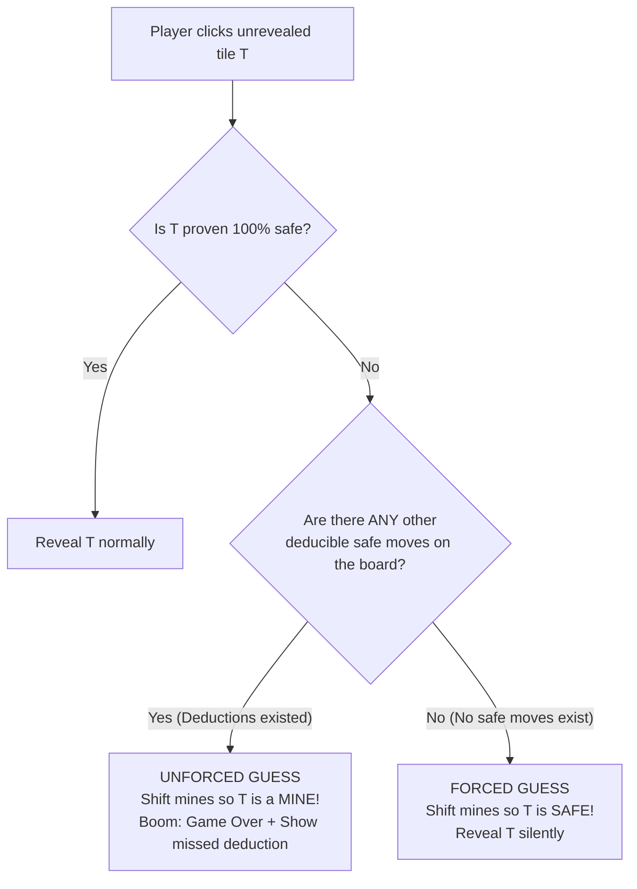

# Fair & Strict Minesweeper: Game Design & Architecture Document

## 1. Executive Summary & Vision

**Fair Minesweeper** (working title: *Karma Minesweeper* or *LogicSweeper*) is a psychological and logical evolution of classic Minesweeper. 

In traditional Minesweeper, players can execute flawless deductive logic across 99% of a board only to be eliminated by an unavoidable 50/50 coin flip. Conversely, impatient players often guess haphazardly without consequence. 

This variant establishes an unbreakable contract with the player:
> **"If you think, you cannot lose to bad luck. If you gamble when logic was available, you die instantly."**

---

## 2. Core Game Mechanics

### 2.1 Standard Windows Minesweeper Rules & Presets
The game adheres to the classic rules (numbers 1–8 indicating adjacent mines, flagging, right-click marking, chord reveals on double-click/middle-click) and includes standard presets:

| Difficulty | Grid Dimensions | Total Mines | Mine Density |
| :--- | :--- | :--- | :--- |
| **Beginner** | 9 × 9 | 10 | 12.3% |
| **Intermediate** | 16 × 16 | 40 | 15.6% |
| **Expert** | 30 × 16 | 99 | 20.6% |
| **Custom** | 8–50 W × 8–30 H | 1 to $(W \times H - 9)$ | Customizable |

- **First-Click Guarantee**: The first click is guaranteed to be safe and will always generate an opening (revealing a `0` cell with a cascade).

---

### 2.2 Novel Variant Mechanics: The Karma Engine



#### A. Forced Guess Protection (Benevolent Karma)
- **Condition**: The player clicks an unrevealed tile $T$, and the solver determines that across the **entire board**, there are **0 unrevealed tiles that can be logically deduced as 100% safe**.
- **Action**: The board's hidden state dynamically shifts (if $T$ was previously a mine) to ensure $T$ is **safe**.
- **User Feedback**: **No clues or warnings during gameplay**. The move proceeds seamlessly as if the tile was naturally safe. The player must rely purely on their own deductive skills and confidence.

#### B. Unforced Guess Retribution (Punishing Karma)
- **Condition**: The player clicks an unrevealed tile $T$ whose safety is not guaranteed ($P(\text{safe}) < 1.0$), **and** there exists at least one other unrevealed tile on the board that was $100\%$ logically deducible as safe.
- **Action**: The board's hidden state dynamically shifts (if $T$ was not already a mine) to place a mine on $T$, guaranteeing that the player **detonates and loses**.
- **User Feedback**: Game Over screen with an educational post-mortem visualizer:
  - All remaining hidden mines are revealed (with the detonated mine on the clicked tile 100% of the time).
  - The board highlights a tile that was **certain to be safe** with the information available at the time.
  - Highlights the specific clue number(s) that proved it safe, accompanied by a concise explanation.

#### C. Debug Mode & Time Machine (Undo After Death)
- **Purpose**: For testing, practicing, and validating deductions without needing to restart the board from scratch.
- **Trigger**: Hotkey (`Ctrl+Z` / `U`), cheat code (`xyzzy`), or a visible "Undo" / "Rewind" button available upon death in debug mode.
- **Mechanics**: The Python engine records a state snapshot stack before each action. Undoing rewinds the board to the exact state before the fatal click, allowing the player/developer to test clicking other tiles or explore different logical deductions from that exact state.

---

## 3. Solver Algorithm & Dynamic Mine Shifting

### 3.1 Constraint Satisfaction Problem (CSP)
At the moment the user clicks tile $T$ (evaluated on-demand, without tracking all past game branches):
1. **Frontier Extraction**: Group all unrevealed cells adjacent to at least one revealed numbered cell.
2. **Equation Formulation**: For each revealed numbered tile $k$ with number $V_k$, already flagged mines $F_k$, and unrevealed neighbors $U_k$:
   $$\sum_{x \in U_k} x = V_k - F_k \quad \text{where } x \in \{0, 1\}$$
3. **Partitioning into Independent Subcomponents**:
   - Split disjoint frontier regions into connected components to minimize combinatorial search.
4. **Tank Solver / Backtracking**:
   - Enumerate valid binary assignments for each component.
   - Filter assignments against remaining global mine count and floating (unconnected) cells.
5. **Deduction Classification**:
   - **Guaranteed Safe**: Cells that equal $0$ in **100% of all valid configurations**.
   - **Guaranteed Mine**: Cells that equal $1$ in **100% of all valid configurations**.
   - **Ambiguous (Guesses)**: Cells that equal $1$ in some configurations and $0$ in others ($0 < P(\text{mine}) < 1$).

### 3.2 Dynamic Mine Realignment ("On-Demand Quantum Collapse")
- **When punishing**: Shift an unconstrained mine to $T$ (always possible because $T$ is ambiguous and can be a mine without violating revealed clues). Detonate $T$.
- **When protecting**: Shift the mine from $T$ to an unconstrained interior/floating cell or ambiguous frontier cell. Reveal $T$ safely.

---

## 4. Pure Static Web Architecture (Pyodide / WASM)

```
┌─────────────────────────────────────────────────────────────┐
│                 Browser Client (Static Web)                 │
│                                                             │
│  UI Layer (HTML5, Vanilla CSS, JS):                         │
│  - Modern Glassmorphic HUD & Grid Canvas/DOM                │
│  - Mouse/Touch controls (Left click, Right click, Chording) │
│  - Sound effects (Web Audio API) & Timer                    │
│  - Post-mortem visualizer (Highlights safe cell & clues)   │
│  - Debug Controls ("Undo / Rewind Move", State Inspector)   │
│                                                             │
│  ▲                                                          │
│  │ JS / Python Bridge                                       │
│  ▼                                                          │
│                                                             │
│  Pyodide WebAssembly Python Runtime:                        │
│  - Runs standard Python directly inside browser worker/page │
│  - fair_minesweeper/                                        │
│    ├── board.py       (Board state, reveals, flags, undo)  │
│    ├── solver.py      (CSP solver, deduction identifier)    │
│    └── karma.py       (On-demand mine shifting & rules)     │
└─────────────────────────────────────────────────────────────┘
```

### 4.1 Benefits of Pure Static Hosting
- **Zero Server Costs & Maintenance**: Can be deployed to GitHub Pages, Cloudflare Pages, Netlify, Vercel, or any static file host.
- **100% Python Engine**: All game logic, CSP solving, deduction discovery, and mine-shifting are implemented in Python as requested.
- **Instant Local Testing**: Runs locally with any simple static server (e.g. `python -m http.server 8000`).

---

## 5. UI / UX Design & Aesthetics

- **Palette**: Dark slate aesthetic (`#0f172a`, `#1e293b`) with crisp neon accents for numbers (1: Cyan, 2: Emerald, 3: Coral, 4: Violet, etc.).
- **Board Interactions**: Tactile tile states, crisp hover feedback, smooth cascade animations.
- **Classic HUD**: Digital 7-segment/monospace mine counter, reset smiley face button, and elapsed timer.
- **No In-Game Guess Clues**: Authentic classic Minesweeper tension—no badges or hints telling you whether a move is a guess or deducible.
- **Post-Mortem Visualizer**:
  - Highlights detonated mine in red.
  - Reveals all other mines on the board.
  - Highlights one guaranteed safe tile in bright emerald green.
  - Highlights the specific clue(s) that proved it safe in cyan.
  - Displays a concise 1-sentence deduction summary (e.g., *"Clue '1' at (3, 4) already has all mines flagged; neighbor (3, 5) was safe."*).
- **Debug Mode**:
  - An "Undo Last Move" button (or `Ctrl+Z`) activates upon game over or via toggle, allowing instant rewinding to test other paths.

---

## 6. Implementation Roadmap

1. **Step 1: Python Core Engine & Solver (`fair_minesweeper/`)**
   - `board.py`: Board grid, mine initialization, reveals, cascade, flags, and undo history stack.
   - `solver.py`: Connected-component CSP solver to classify safe cells, mines, and ambiguities.
   - `karma.py`: On-demand logic check, benevolent protection, and unforced guess punishment.
   - Comprehensive unit test suite (`tests/`) verifying forced-guess survival, unforced-guess death, and undo mechanism.
2. **Step 2: Static Web App & Pyodide Integration**
   - `index.html`, `style.css`, and `app.js` with responsive glassmorphic UI.
   - Load and mount Pyodide in the browser; expose clean JS API to the Python engine.
3. **Step 3: Post-Mortem Visualizer & Debug Mode**
   - Visual highlighting of safe cell and clue numbers on game over.
   - Interactive Undo button / hotkey for rapid experimentation.
4. **Step 4: End-to-End Testing & Polish**
   - Test on desktop and mobile browsers.
   - Validate performance across Beginner, Intermediate, and Expert presets.
